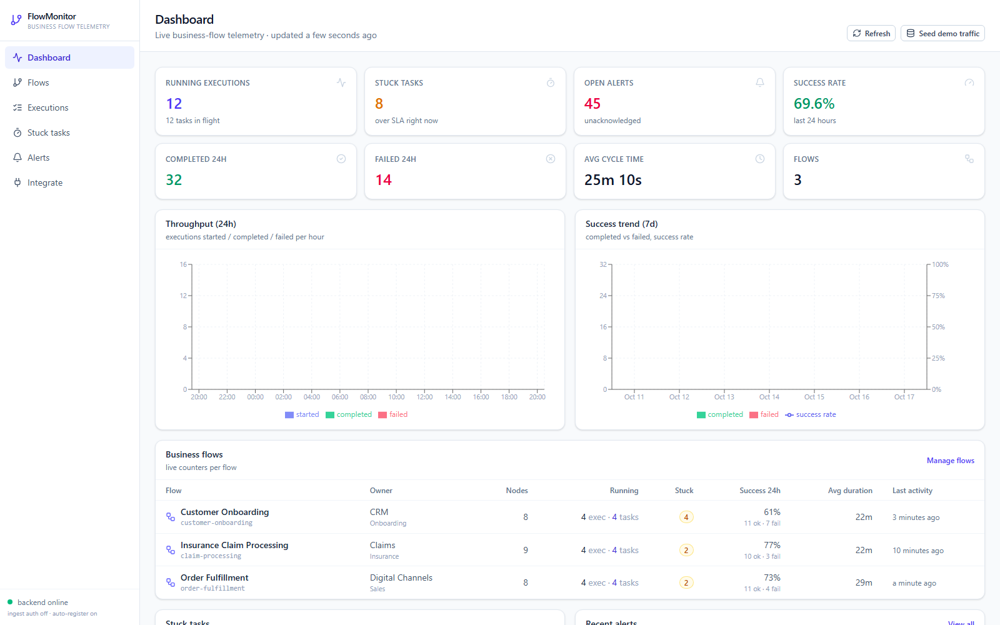
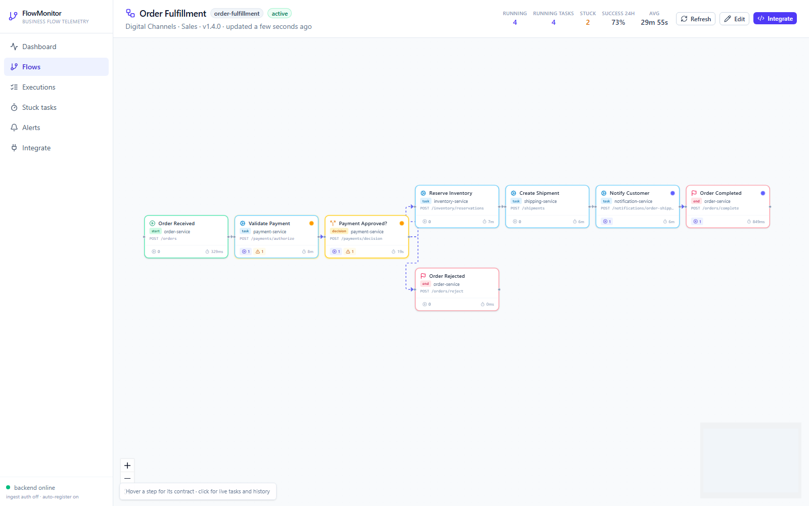
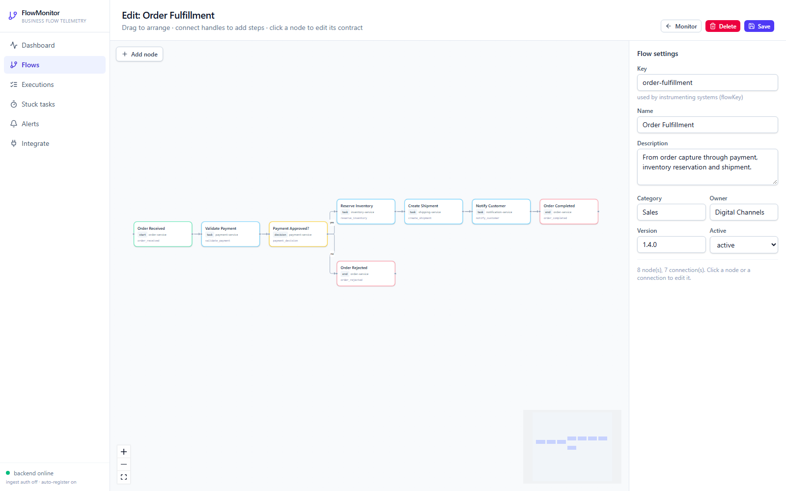
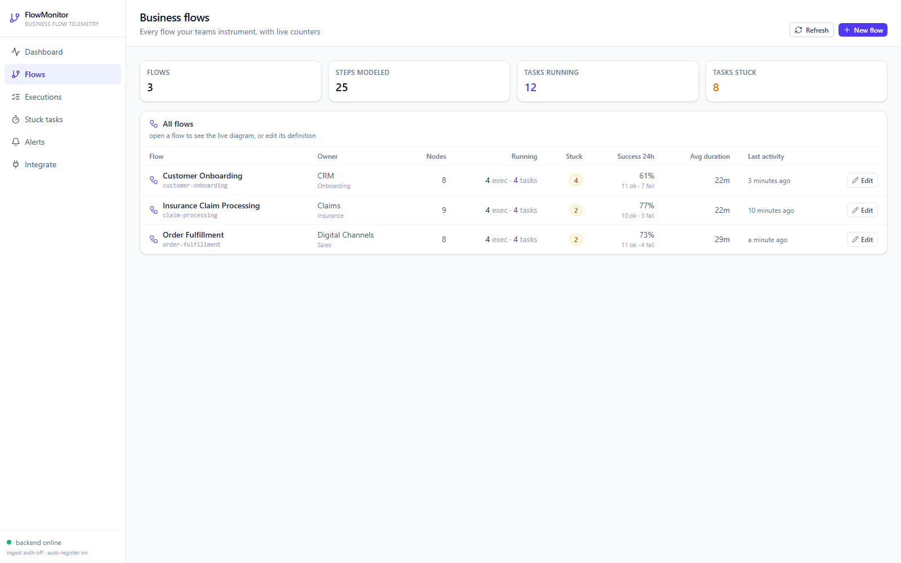
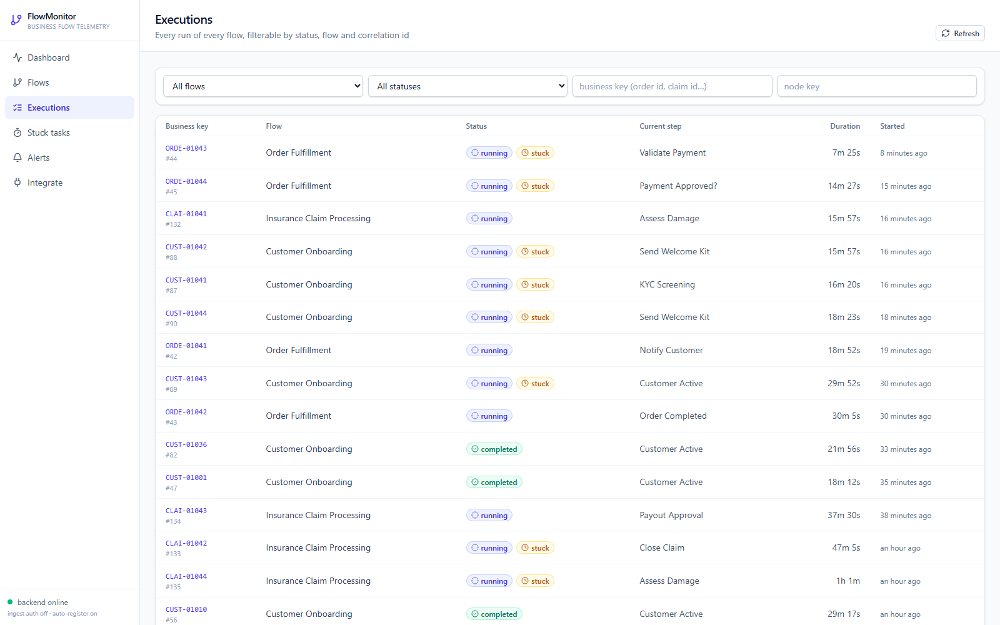
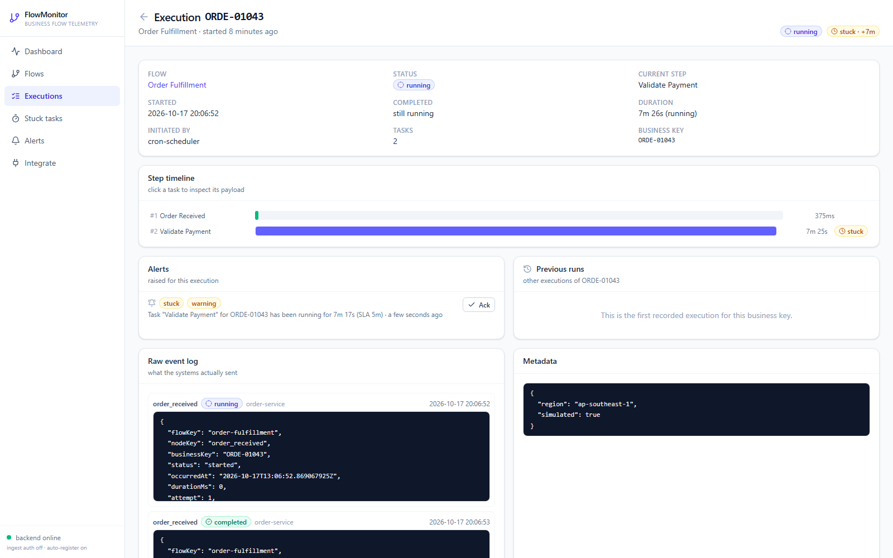
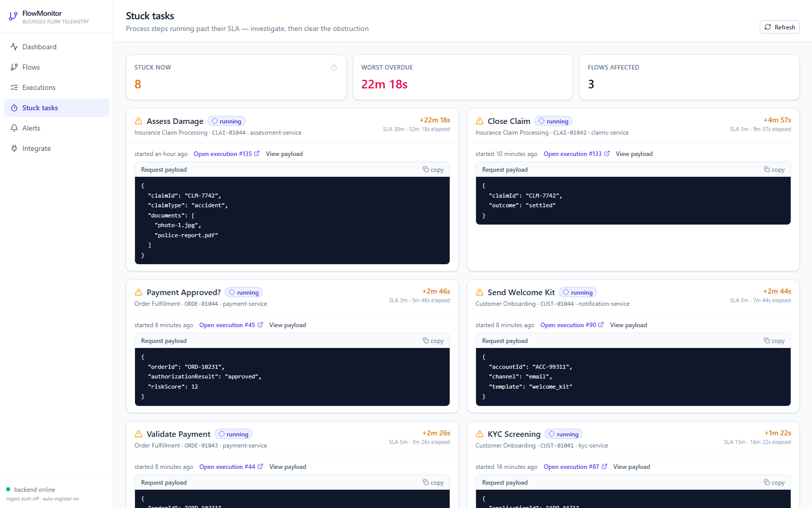
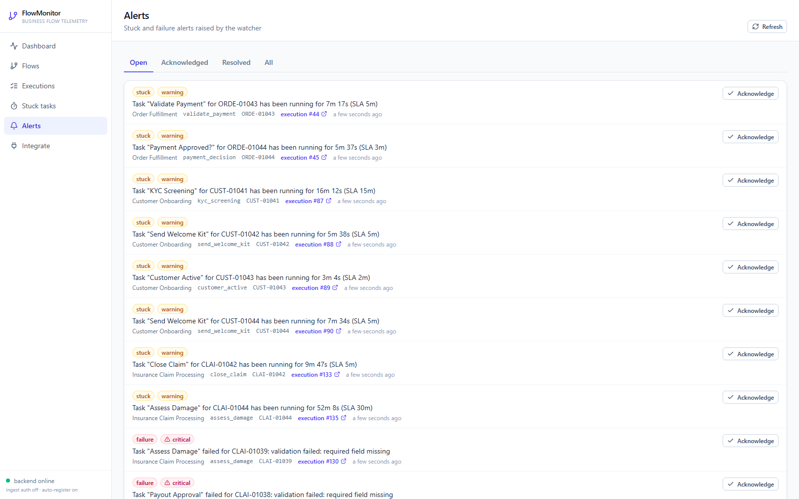
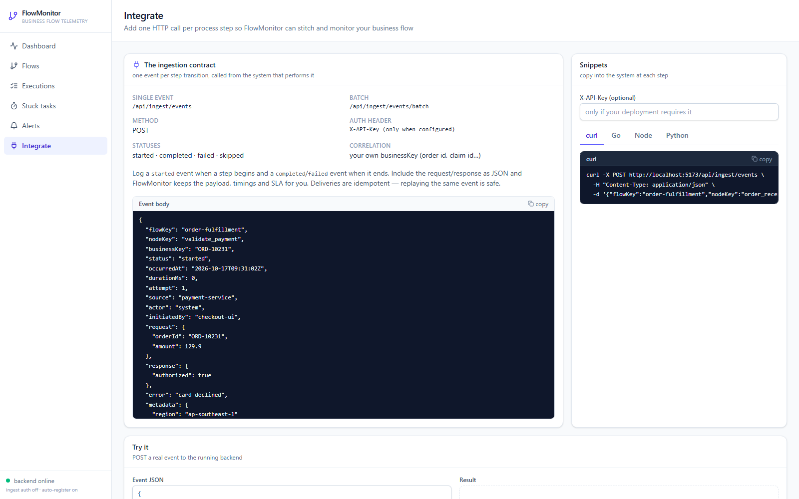

# FlowMonitor — business flow monitoring

**FlowMonitor turns your business processes into live diagrams.** Teams draw a flow as a diagram
once, then every participating system logs a single HTTP call at each process step. FlowMonitor
stitches those events into executions and answers the questions that matter in production:

- *What is running right now, and where?*
- *Which tasks are stuck on a process — and what payload are they holding?*
- *What happened on this step last time, and the time before?*

It is a small, self-contained system: one Go API (SQLite, no external services) and one React UI.
It ships with three fully-specified demo flows and ~72 hours of simulated traffic, so it is useful
the moment you start it.



---

## Screenshots

All screenshots below are of the running app with the built-in demo data. Regenerate them with
`scripts/capture-screenshots.ps1` (see [Regenerating screenshots](#regenerating-screenshots)).

### Live flow diagram
Open a flow to see its processes as a diagram. Each node shows its live counters — running tasks,
stuck tasks, average duration — and edges animate while work is flowing through them. Hover a node
for its contract, click it to drill in.



### Flow editor
Build the diagram by dragging nodes and connecting handles. Each step carries its contract: which
system and repository runs it, the endpoint and method, the parameters it accepts, a sample
response, and its SLA.



### Business flows
Every flow your teams instrument, with live counters, success rate and last activity.



### Executions
Every run of every flow, filterable by flow, status (including `stuck`), business key and node.



### Execution detail
One execution, with a step timeline, per-task payloads, the raw event log, the alerts raised for
it, and the previous executions of the same business key.



### Stuck tasks
Tasks running past their SLA, sorted by how far overdue they are, with the request payload they
are holding and a link straight to the execution.



### Alerts
Stuck and failure alerts raised by the background watcher, with acknowledgement.



### Integrate
The exact ingestion contract, copy-paste snippets for curl / Go / Node / Python, a per-flow
manifest of what each step expects, and a live "try it" box that posts a real event.



---

## How it works

FlowMonitor keeps **definitions** and **telemetry** strictly apart:

| Layer | Tables | Written by |
| --- | --- | --- |
| Definition | `flows`, `flow_nodes`, `flow_edges` | the editor / `POST`·`PUT /api/flows` |
| Telemetry | `runs`, `step_runs`, `events` | ingestion only (`POST /api/ingest/events`) |
| Alerting | `alerts` | the background stuck/failure watcher |

Because they are separate, editing a diagram never rewrites history, and re-pointing an edge never
loses data.

- **Execution** (`run`) — one pass of a flow for a `businessKey` (an order id, a claim id…).
- **Task** (`step_run`) — one node execution inside an execution: timings, attempt, request/response
  payload, source system, error.
- **Event** — the raw ingested log line, kept verbatim for auditing.

### The ingestion state machine

A system logs `started` when a step begins and `completed` / `failed` / `skipped` when it ends.

- `started` opens a task (or reuses the one already open for that node).
- A terminal status closes the open task; if none is open, a closed task is synthesised — so
  single-shot instrumentation works too.
- When a task fails, the execution fails and a `failure` alert is raised.
- Ingestion is **idempotent**: `dedupe_hash = sha256(flowKey|businessKey|nodeKey|status|occurredAt|attempt)`,
  so replaying an identical event changes nothing.
- Unknown flows/nodes are **auto-registered** as placeholders, so instrumentation never loses
  telemetry; complete their contract in the editor later.

### Stuck detection

A task is **stuck** when it is still running and `now - started_at` exceeds its node SLA
(`timeoutMinutes`, falling back to `FLOWMON_DEFAULT_SLA_MINUTES`). It is computed on read so the UI
is always accurate, and a background watcher materialises `stuck` alerts (resolving them when the
task finishes).

---

## Quick start

Two terminals. The backend creates `flowmon.db`, seeds three demo flows and simulates history on
first run.

```bash
# terminal 1 — API on :8080
cd backend
go mod tidy          # first time only
go run ./cmd/server
```

```bash
# terminal 2 — UI on :5173 (proxies /api → :8080)
cd frontend
npm install          # first time only
npm run dev
```

Open <http://localhost:5173> → **Flows → Order Fulfillment**.

Useful environment switches (full list in [`backend/README.md`](backend/README.md#configuration)):

| Env var | Default | Purpose |
| --- | --- | --- |
| `FLOWMON_SEED_DEMO` | `true` | load demo flows + simulated traffic on an empty DB |
| `FLOWMON_INGEST_KEY` | *(empty)* | when set, ingestion requires `X-API-Key` |
| `FLOWMON_DEFAULT_SLA_MINUTES` | `60` | fallback SLA (`0` disables stuck detection) |
| `FLOWMON_AUTO_REGISTER` | `true` | auto-create unknown flows/nodes on ingest |

---

## Instrument your systems

Add one HTTP call at each step, from the system that performs it:

```bash
curl -X POST http://localhost:8080/api/ingest/events \
  -H "Content-Type: application/json" \
  -d '{
    "flowKey":     "order-fulfillment",
    "nodeKey":     "validate_payment",
    "businessKey": "ORD-10231",
    "status":      "started",
    "source":      "payment-service",
    "request":     { "orderId": "ORD-10231", "amount": 129.9 }
  }'
```

Then the same call with `"status": "completed"` (optionally `response` and `durationMs`) or
`"status": "failed"` (with `error`). `businessKey` is your own correlation id — it ties every step
of one execution together.

| Endpoint | Purpose |
| --- | --- |
| `POST /api/ingest/events` | log one task event |
| `POST /api/ingest/events/batch` | log many events in one call |
| `GET /api/ingest/manifests/:flowKey` | what to instrument for a flow (systems, endpoints, params, sample responses) |

Accepted `status` values are `started`, `completed`, `failed`, `skipped`. The **Integrate** page in
the UI generates ready-to-paste curl / Go / Node / Python snippets for your flows and lets you post
a test event.

---

## API overview

| Area | Endpoints |
| --- | --- |
| Health & overview | `GET /api/health`, `GET /api/dashboard` |
| Ingestion | `POST /api/ingest/events`, `POST /api/ingest/events/batch`, `GET /api/ingest/manifests/:flowKey` |
| Flow definitions | `GET|POST /api/flows`, `GET|PUT|DELETE /api/flows/:idOrKey`, `GET /api/flows/:idOrKey/stats`, `GET /api/flows/:idOrKey/nodes/:nodeKey` |
| Executions & tasks | `GET /api/runs`, `GET /api/runs/:id`, `GET /api/runs/:id/steps/:stepId`, `GET /api/steps`, `GET /api/tasks/stuck`, `GET /api/business-keys/:key/runs` |
| Alerts | `GET /api/alerts`, `POST /api/alerts/:id/ack` |
| Demo | `POST /api/demo/seed` |

`:idOrKey` accepts either a numeric id or the flow key. Response shapes and the full field-level
reference live in [`backend/README.md`](backend/README.md) and
[`docs/system-design.md`](docs/system-design.md).

---

## Project layout

```
prototyping/
├── backend/                    # Go · Gin · GORM · SQLite API
│   ├── cmd/server/             # entrypoint: config → db → migrate → seed → watcher → routes
│   └── internal/               # config, database, models, dto, service, handlers, routes, seed
├── frontend/                   # React · React Flow · Tailwind monitoring UI
│   └── src/                    # lib (api/types/format), components, diagram, pages
├── docs/
│   ├── system-design.md        # data model, ingestion contract, API + route tables
│   └── screenshots/            # images used in this README
└── scripts/
    └── capture-screenshots.ps1 # regenerate the screenshots
```

---

## Stack

**Backend** — Go · [Gin](https://github.com/gin-gonic/gin) · [GORM](https://gorm.io) · SQLite via
`glebarez/sqlite` (pure Go — no CGO/gcc needed on Windows).

**Frontend** — React 19 + TypeScript · Vite 6 · [`@xyflow/react`](https://reactflow.dev) (React Flow
12) for the diagrams · Tailwind CSS v4 · TanStack Query (polling) · React Router 7 · axios · dayjs ·
lucide-react · recharts.

---

## Development

```bash
# backend: tests + vet + build
cd backend && go test ./... && go vet ./... && go build ./...

# frontend: type-check + production build
cd frontend && npm run build
```

The frontend enables `noUnusedLocals` / `noUnusedParameters`, so unused imports break the build.
`src/lib/types.ts` mirrors `backend/internal/dto/dto.go` — keep them in sync when a DTO changes.

### Regenerating screenshots

With Chrome (or Edge) installed on Windows:

```powershell
powershell -ExecutionPolicy Bypass -File scripts/capture-screenshots.ps1
```

The script builds the backend, starts it seeded, starts the Vite dev server, screenshots every
screen into `docs/screenshots/`, and then stops both servers.
